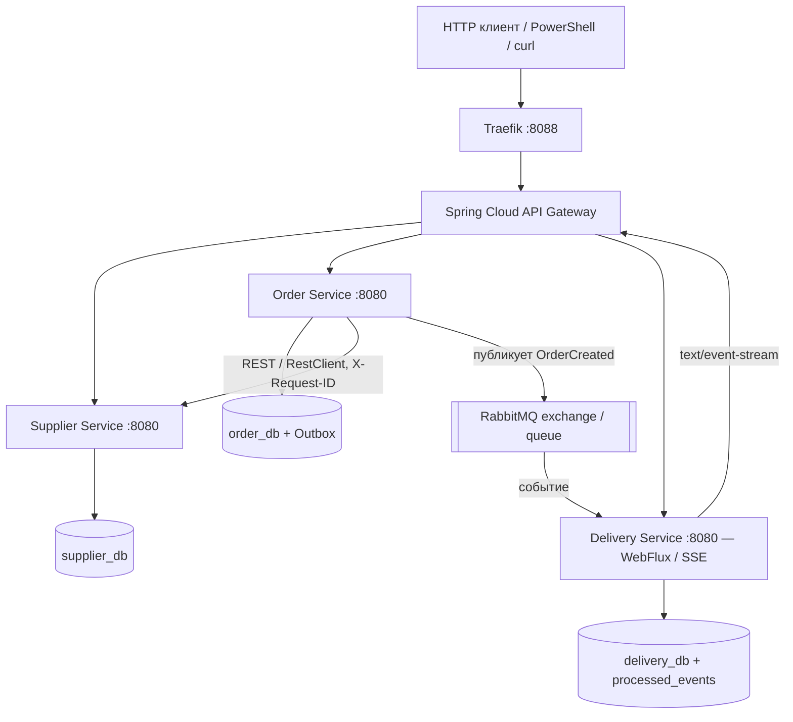

# Практическая работа №8 — итоговая микросервисная система даркстора и доставки

**Предметная область:** АС сервиса доставки — товары / поставщики → заказ → доставка.

**Стек:** Java 21, Spring Boot 3.5.16, Spring Cloud Gateway 2025.0.3, Spring MVC, Spring WebFlux / Project Reactor, RestClient, RabbitMQ, PostgreSQL (3 независимых экземпляра), Spring Data R2DBC (Delivery Service), JDBC (Supplier, Order), Resilience4j Circuit Breaker/Retry, Spring Boot Actuator, Traefik v3.7.17, Docker Compose.

Это отдельный проект — **все сервисы запускаются командой `docker compose up --build -d`**, без ручного запуска `java -jar`.

## Архитектура



- **Supplier Service**: товары, поставщики, остатки, доступность товара; собственная БД `supplier_db`.
- **Order Service**: создание и чтение заказов; синхронная проверка товара через RestClient с `connect=600ms`, `read=900ms`, Retry x2 и Circuit Breaker. Транзакционная запись заказа и события в outbox таблице собственной БД `order_db`.
- **Delivery Service**: подписка RabbitMQ на `OrderCreated`; собственная БД `delivery_db`; уникальный `order_id` и таблица `processed_events(event_id)` для идемпотентности; HTTP API на WebFlux `Mono`/`Flux`; SSE для обновления доставки. R2DBC исключает блокирующие DB-вызовы из HTTP-обработчиков.
- **Gateway**: Spring Cloud Gateway, три маршрута и фильтр `X-Request-ID`; `GET /api/system/health` агрегирует состояния бизнес-сервисов.
- **Traefik**: внешняя инфраструктурная маршрутизация на единый Gateway.

> В RabbitMQ listener есть ограниченное по времени `.block(Duration...)` **только в выделенном AMQP worker**, чтобы подтверждать сообщение уже после завершения транзакции R2DBC. В HTTP-контроллерах WebFlux `block()` не используется.

## 1. Запуск (Windows 11 / Docker Desktop)

Требования: **Docker Desktop**, запущенный Linux containers mode, свободны порты `8088`, `8089`, `15672`, интернет для загрузки образов и Maven-зависимостей при первом запуске. Примерная память 4+ ГБ. Компиляцию Java делает **внутри Docker** Maven, локально устанавливать Maven не обязательно.

В PowerShell перейти в папку, где находится `compose.yaml`:

```powershell
docker compose up --build -d
docker compose ps
```

При первом запуске сборка четырёх Maven-модулей и загрузка образов может занять время. Успешная готовность — все сервисы healthy и:

```powershell
Invoke-RestMethod http://localhost:8088/api/system/health | ConvertTo-Json
```

Ожидается (порядок полей не гарантируется):

```json
{"gateway":"UP","supplier":"UP","order":"UP","delivery":"UP"}
```

- **Единственный бизнес API:** `http://localhost:8088` → Traefik → Gateway.
- **Traefik Dashboard:** `http://localhost:8089/dashboard/` (только на localhost).
- **RabbitMQ Management UI:** `http://localhost:15672` (логин `demo`, пароль `demo123`, только на localhost).
- Сервисы, базы данных и AMQP порт снаружи Docker **не опубликованы**.

Проверить тесты без отдельного локального Maven можно внутри Maven контейнера:

```powershell
docker run --rm -v "${PWD}:/workspace" -w /workspace maven:3.9-eclipse-temurin-21 mvn -B test
```

## 2. HTTP-проверки и события

### GET (Supplier, Order и Delivery)

```powershell
Invoke-RestMethod http://localhost:8088/api/products | Format-Table
Invoke-RestMethod http://localhost:8088/api/suppliers | Format-Table
Invoke-RestMethod http://localhost:8088/api/orders | ConvertTo-Json -Depth 5
Invoke-RestMethod http://localhost:8088/api/deliveries | ConvertTo-Json -Depth 5
```

Товары взяты из CSV предыдущей практической №7 (10 продуктов: «Пицца Маргарита», «Салат Цезарь», и др.). Суммы хранятся в **копейках** (`priceKopecks`). Например, товар №1 стоит `59999` коп., то есть 599,99 ₽.

### POST + синхронный запрос + событие

```powershell
$rid = "demo-" + [guid]::NewGuid().ToString("N")
$order = Invoke-RestMethod -Method Post -Uri http://localhost:8088/api/orders `
    -Headers @{"X-Request-ID"=$rid} -ContentType "application/json; charset=utf-8" `
    -Body '{"productId":1,"quantity":2}'
$order | ConvertTo-Json
```

Траектория:

```text
Client (X-Request-ID = demo-...)
  -> Traefik -> Gateway
  -> Order Service
       -> HTTP RestClient -> Supplier Service (проверка товара)
       <- available=true, unitPriceKopecks=59999
       -> транзакция БД: orders + outbox_events
  -> 201 Created, orderId=N
  ... планировщик OutboxPublisher ...
  -> RabbitMQ orders.exchange / order.created / delivery.order-created
  -> Delivery Service (@RabbitListener)
       -> INSERT processed_events(event_id) ON CONFLICT DO NOTHING
       -> INSERT deliveries(order_id) ON CONFLICT DO NOTHING
  -> GET /api/deliveries/by-order/N
```

Через секунду или две проверить, что асинхронный потребитель создал доставку:

```powershell
Invoke-RestMethod "http://localhost:8088/api/deliveries/by-order/$($order.id)" | ConvertTo-Json
```

Отсутствие доставки в течение пары первых секунд допустимо — это пример **eventual consistency**. Если долго нет — проверить логи.

### Идемпотентность: повторное событие

`replay-event` — отдельный **учебный endpoint**, который повторяет **исходное** событие с **тем же eventId**; в производственной системе его следует убрать или защитить.

```powershell
Invoke-RestMethod -Method Post "http://localhost:8088/api/orders/$($order.id)/replay-event"
Start-Sleep 2
Invoke-RestMethod "http://localhost:8088/api/deliveries/by-order/$($order.id)"
```

В логах Delivery Service ожидается `duplicateIgnored=true`. Доставка остаётся **одной**: уникален `order_id`, а `event_id` фиксируется в `processed_events`.

### SSE в реальном времени

1. Зафиксировать `delivery.id` из ответа `/api/deliveries/by-order/$($order.id)`; допуская, что это `1`, открыть новое окно PowerShell:

   ```powershell
   curl.exe -N -H "Accept: text/event-stream" http://localhost:8088/api/deliveries/1/events
   ```

   В начале приходит snapshot `CREATED`, затем консоль не завершается, а ждёт новые события. Не путать `orderId` и `deliveryId`: они могут не совпадать.

2. В другом окне, **пока SSE открыт**, выполнить:

   ```powershell
   $deliveryId = 1 # заменить на фактический delivery.id
   $rid = "demo-sse-" + [guid]::NewGuid().ToString("N")
   foreach ($status in @('ACCEPTED','IN_TRANSIT','DELIVERED')) {
       $body = @{status=$status} | ConvertTo-Json
       Invoke-RestMethod -Method Put -Uri "http://localhost:8088/api/deliveries/$deliveryId/status" `
           -Headers @{'X-Request-ID'=$rid} -ContentType 'application/json' -Body $body | ConvertTo-Json
       Start-Sleep -Seconds 2
   }
   ```

3. В первом окне по мере PUT придут `event: delivery-status`, `data: ..."status":"ACCEPTED"`, затем `IN_TRANSIT` и `DELIVERED`. SSE — однонаправленный поток **сервер → клиент**. Соединение держится открытым; закрыть через `Ctrl+C`.

4. Для скриншота откройте оба терминала одновременно (в одном SSE, в другом PUT).

Возможные ошибки: нельзя сразу перейти из `CREATED` в `DELIVERED` (HTTP 409). Нельзя менять статус уже доставленного заказа.

### Полный демонстрационный скрипт

```powershell
powershell -ExecutionPolicy Bypass -File .\scripts\demo.ps1
```

Скрипт создаёт новый заказ, ожидает событие и доставку, воспроизводит дубликат и пошагово меняет статусы. Для **живого** SSE нужно подключиться до PUT; можно отдельно создать новый заказ и повторить вручную. Скрипт не подменяет реальные скриншоты.

## 3. Отказоустойчивость: Supplier OFF

**Сценарий без ручного запуска сервисов**: Compose управляет контейнерами, бизнес API остаётся доступен через Traefik.

```powershell
docker compose stop supplier-service
Invoke-RestMethod http://localhost:8088/api/system/health | ConvertTo-Json
```

В ответе ожидается `"supplier":"DOWN"`, остальные — `UP`.

```powershell
$sw = [Diagnostics.Stopwatch]::StartNew()
try {
    Invoke-RestMethod -Method Post http://localhost:8088/api/orders `
        -ContentType 'application/json' -Body '{"productId":1,"quantity":2}'
} catch { Write-Host "Ожидаемая ошибка: $($_.Exception.Message)" }
$sw.Stop(); $sw.Elapsed
```

Ожидаем **HTTP 503**, без бесконечного ожидания. RestClient ограничен тайм-аутом подключения и чтения, Retry — 2 попытками, Circuit Breaker открывается при устойчивой недоступности. Проверка его состояния:

```powershell
Invoke-RestMethod http://localhost:8088/api/orders/circuit-state
```

Восстановить через Compose (не напрямую Java):

```powershell
docker compose start supplier-service
docker compose ps
```

После запуска и не менее ~8 секунд при открытом Circuit Breaker повторить POST заказа — снова 201. **Не запускай `docker compose down -v`** до сдачи, это удалит данные всех трёх БД.

Есть готовый сценарий:

```powershell
powershell -ExecutionPolicy Bypass -File .\scripts\failure.ps1
```

## 4. Корреляция запросов X-Request-ID

В Gateway генерируется UUID, если заголовок не указан. Он передаётся в Order Service, далее в Supplier Service, затем сохраняется в событии `OrderCreated`, и Delivery Service выводит его в логи при обработке RabbitMQ. Проверка:

```powershell
$rid = 'pr8-trace-001'
Invoke-RestMethod -Method Post http://localhost:8088/api/orders `
 -Headers @{'X-Request-ID'=$rid} -ContentType 'application/json' `
 -Body '{"productId":2,"quantity":1}'
Start-Sleep 3
docker compose logs --since 5m api-gateway supplier-service order-service delivery-service | Select-String $rid
```

Ожидаются строки **gateway → order → supplier → delivery** с тем же `requestId`. Учти, что запись `eventPublished` в Outbox связывается по `eventId`, а непосредственная лог-строка публикации может не содержать `requestId`.

## 5. RabbitMQ и проверка обмена

RabbitMQ Management: `http://localhost:15672` (`demo` / `demo123`).

- Exchange: `orders.exchange` (direct, durable)
- Routing key: `order.created`
- Queue: `delivery.order-created` (durable)
- Publisher: Order Service / OutboxPublisher (publisher confirms)
- Consumer: Delivery Service / RabbitConsumer
- Body: `{eventId,orderId,productId,quantity,totalKopecks,requestId}` — только необходимые данные.

Логи с успешной доставкой события:

```powershell
docker compose logs --since 5m order-service delivery-service | Select-String 'eventPublished|eventReceived|deliveryCreated|duplicateIgnored'
```

## 6. Проверка тестов

```powershell
docker run --rm -v "${PWD}:/workspace" -w /workspace maven:3.9-eclipse-temurin-21 mvn -B test
```

JUnit / Mockito: проверка некорректного количества, недостатка остатков, последовательности статусов и `StepVerifier`, передачи `X-Request-ID` в API Gateway.

## 7. Сравнение технологий

| Задача | Использованная технология |
| --- | --- |
| Наружная маршрутизация | Traefik |
| API маршрутизация между сервисами | Spring Cloud Gateway |
| Синхронное взаимодействие | HTTP RestClient (Order → Supplier) |
| События | RabbitMQ (OrderCreated) |
| Реактивные HTTP endpoint'ы | Spring WebFlux, Mono, Flux, R2DBC (Delivery) |
| Потоковые уведомления | Server-Sent Events (SSE) |
| Собственные базы | PostgreSQL × 3 |
| Корреляция | X-Request-ID в HTTP + в Rabbit event |
| Устойчивость к повтору | UNIQUE(order_id) + processed_events(event_id) |
| Устойчивость к отправке | Transactional Outbox + confirms + retry |
| Таймауты и каскадные отказы | RestClient + Resilience4j Retry + CircuitBreaker |
| Состояние сервисов | Spring Boot Actuator и GET /api/system/health |

### Что не заявляется

Это учебная архитектура. Складской остаток проверяется, но **не резервируется атомарно**; при конкурирующих заказах нужна отдельная операция резерва. SSE хранится в памяти процесса (подключившийся позже клиент видит текущий snapshot, не исторические события); для горизонтального масштабирования потребуется внешняя шина. Outbox доставляет события **как минимум один раз**, не гарантирует глобального порядка. Демонстрационный replay endpoint не предназначен для production. Нет авторизации — внешние порты привязаны к `127.0.0.1`, но это только учебная мера.

### Отличие от старой методички

Приложенная методичка 2023–2024 на странице 15 также требует **OAuth2, Spring Cloud Config/Git, Service Discovery, Load Balancer, FeignClient и размещение в облаке/Minikube**. **Обновлённое задание BootcampLabs**, приведённое в сообщении, содержит **другой набор требований**: RabbitMQ, Outbox/idempotency, timeouts, Circuit Breaker, SSE, Docker Compose. Проект реализует именно **обновлённое задание**; выполнение абсолютно всех пунктов старой методички этим архивом не заявляется.

## 8. Что сдать

1. Исходники из этого проекта в репозитории, например `PRKSP2/Task8`; после самостоятельной публикации указать фактическую ссылку (не выдавать архив за уже загруженный в GitHub).
2. Архитектурная Mermaid-схема из данного README.
3. 3–5 скриншотов полного сценария: GET товаров, POST заказа, появление доставки после RabbitMQ, PUT статусов, SSE.
4. `docker compose ps` со всеми работающими контейнерами.
5. `docker compose logs` с одинаковым `requestId` через Gateway/Order/Supplier/Delivery.
6. RabbitMQ Management (exchange/queue) + логи `eventReceived` и `deliveryCreated`.
7. Отказ: сервис supplier OFF, `/api/system/health` DOWN, HTTP 503, восстановление.
8. Реальный скриншот отметки «курс завершён» в BootcampLabs.

**ВАЖНО:** Приложение не содержит вымышленных скриншотов и не может подтвердить завершение внешнего курса. Сделай их после запуска у себя.

## 9. Частые проблемы

- **Порт 8088 занят**: `netstat -ano | findstr :8088` — остановить старый Docker Compose проект №5 или поменять внешний порт Traefik.
- **Нехватка памяти**: увеличить память Docker Desktop (рекомендуется от 4 ГБ), убрать оставшиеся контейнеры прошлых практик.
- **502 при первом старте**: подождать `docker compose ps` → healthy; посмотреть `docker compose logs -f`.
- **Доставка ещё не появилась**: событие асинхронно, подождать или проверить `OutboxPublisher` и `RabbitConsumer`.
- **PowerShell не запускает скрипт**: `powershell -ExecutionPolicy Bypass -File .\scripts\demo.ps1`.
- **В Windows `curl` ведёт себя странно**: использовать именно `curl.exe -N`, а не alias PowerShell.
- **Русский текст искажён**: `[Console]::OutputEncoding = [Text.Encoding]::UTF8`, `$OutputEncoding = [Text.Encoding]::UTF8`.
- **Нужно сбросить данные**: `docker compose down -v` удаляет все данные и историю тестирования. Делать только осознанно.
